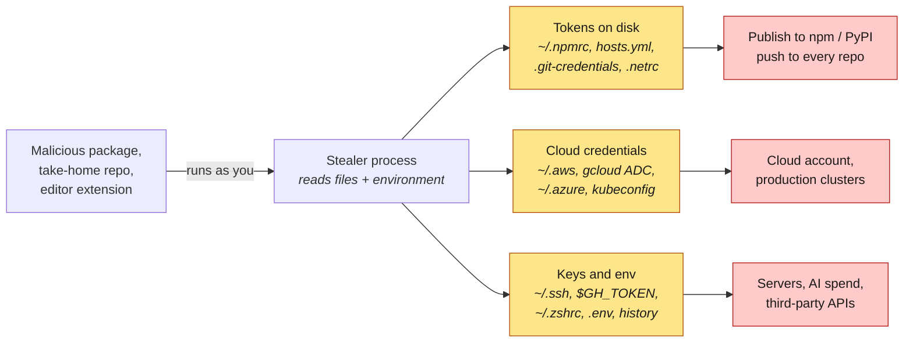

# blastradius

**If a credential stealer ran on your laptop today, what would it walk away with?**

`blastradius` is an offline inventory of the credentials sitting on a developer
workstation: GitHub and npm tokens, cloud keys, kubeconfigs, SSH keys, AI-provider
API keys, `.env` files, secrets typed into the shell history. For each one it tells
you where it is, what it unlocks, whether it expires, and what to do about it. It
never prints a secret: every entry shows the first 8 hex characters of the secret's
SHA-256 instead.

It is the companion to [preflight](https://github.com/howardhsieh/preflight). preflight
asks *"will this repository run code on my machine?"*; blastradius asks *"and if it
does, how bad is it?"*. It was built after the **Shai-Hulud** npm worm (September 2025),
whose payload ran TruffleHog over the victim's home directory, read `~/.npmrc`,
`GITHUB_TOKEN`, AWS/GCP/Azure credentials and `.env` files, then used the npm token it
found to publish itself into the victim's own packages.

```console
$ blastradius scan --dir ~/src

  CRITICAL   laptop   exposure 100/100   52 credentials across 18 services   offline scan

 [CRITICAL] aws  ~/.aws/credentials:1
            Long-term IAM access key (AKIA…) in profile "default", modified 16 months ago
            → profile default  ·  sha256:4b312369  ·  long-term  ·  500 days old
              an IAM user key works from anywhere, needs no MFA from the CLI, and stays valid until rotated
              source credential for role profiles: admin

 [CRITICAL] npm  ~/.npmrc:1
            Legacy npm token for registry.npmjs.org: never expires and is not covered by 2FA
            → registry.npmjs.org  ·  sha256:0bed0453  ·  long-term  ·  400 days old

 [HIGH]     github  ~/.config/gh/hosts.yml:3
            GitHub OAuth token for alice on github.com
            → alice@github.com  ·  sha256:b067392d  ·  long-term
              the same secret is stored in 2 other place(s)
              gh auth login grants repo, read:org, gist and workflow by default: full read/write on every repository you can push to
              also in ~/.git-credentials:1
              also in env:GH_TOKEN

 [HIGH]     ssh  ~/.ssh/id_ed25519
            ssh-ed25519 private key with NO passphrase: copying the file is enough to use it
            → alice@laptop  ·  sha256:0c2f8c1e  ·  long-term  ·  800 days old
              default identity: offered to every host without an explicit IdentityFile
 ...
 Do first:
  1. [CRITICAL] Rotate the long-term AWS access key and move the profile to short-lived credentials
     aws-1, aws-9
  2. [CRITICAL] Revoke the legacy npm token today
     npm-4
  3. [HIGH] Narrow the GitHub token: fine-grained PAT with an expiry, or re-login to gh with fewer scopes
     github-15, github-16
```

(The output above comes from the test fixture: every "secret" in it is the string
`FAKEBLAST` repeated.)

## Threat model



The attacker in this model already has code execution as your user, with no root and
no interactive access. That is exactly what a `postinstall` script, a VS Code task or
a compromised extension gets. blastradius reads the same places a stealer would read
(yellow) and reports what each one reaches (red), so you can shrink the blast radius
*before* the stealer arrives: rotate, shorten, scope, or move into a store that asks
before handing a secret out.

## What it inventories

| Provider | Where | What it reports |
|---|---|---|
| `github` | `~/.config/gh/hosts.yml` | gh OAuth tokens and PATs per host and user; keyring-backed logins are noted, not scored |
| `git-credentials` | `~/.git-credentials`, `~/.config/git/credentials` | plaintext `credential.helper=store` entries, classified by host (GitHub, GitLab, npm, PyPI …) |
| `netrc` | `~/.netrc`, `~/_netrc` | machine/login/password entries |
| `npm` | `~/.npmrc`, project `.npmrc` under `--dir` | `_authToken` (legacy UUID tokens are CRITICAL), `_auth`, `_password`; `${VAR}` references are skipped |
| `pypi` | `~/.pypirc`, `pip.conf` | upload tokens and passwords, index URLs with embedded passwords |
| `aws` | `~/.aws/credentials`, `~/.aws/config`, `sso/cache`, `cli/cache` | long-term `AKIA` keys vs temporary `ASIA` keys, role profiles chained from each key, SSO sessions with expiry |
| `gcp` | `~/.config/gcloud`, `$GOOGLE_APPLICATION_CREDENTIALS` | user refresh tokens (ADC), service-account keys, the `credentials.db` store |
| `azure` | `~/.azure` | MSAL token caches (plaintext vs encrypted), legacy `accessTokens.json`, service-principal secrets |
| `docker` | `~/.docker/config.json`, `containers/auth.json` | plaintext `auth` entries per registry, identity tokens, credential-store usage |
| `kubernetes` | `$KUBECONFIG` / `~/.kube/config` | static tokens, client certificates (subject and expiry parsed), deprecated auth-providers, exec plugins; the contexts and clusters each user reaches |
| `ssh` | `~/.ssh/*`, `~/.ssh/config` | private keys with or without a passphrase (detected from the key header, nothing is decrypted), key type, permissions, which hosts use each key, `ForwardAgent` |
| `ai-tools` | Claude Code, Codex CLI, GitHub Copilot, Gemini CLI, Hugging Face | stored OAuth tokens and API keys |
| `env` | process environment | `GH_TOKEN`, `NPM_TOKEN`, `AWS_SECRET_ACCESS_KEY`, `ANTHROPIC_API_KEY`, `OPENAI_API_KEY`, anything named `*_TOKEN` / `*_SECRET` / `*_KEY` / `*PASSWORD*` |
| `shell-rc` | `~/.zshrc`, `~/.bashrc`, `~/.profile`, fish config … | literal `export NAME=secret` lines (values computed with `$(...)` are fine and skipped) |
| `shell-history` | `~/.zsh_history`, `~/.bash_history`, fish history | `export X_TOKEN=…`, known token shapes (`ghp_`, `npm_`, `AKIA`, `sk-ant-` …), `Authorization:` headers, `--token`/`--password` flags |
| `dotenv` | `.env`, `.env.*` under `--dir` | secret-looking variables with real-looking values; placeholders and `${VAR}` references are skipped |

Run `blastradius providers` for the list. Each credential carries:

- **service** and **kind**: what it unlocks and the shape of the secret;
- **fingerprint**: `sha256(secret)[:8]`, enough to notice the same token in several places (they are merged into one row with "also in" locations) and to compare two scans, not enough to use;
- **lifetime**: `long-term` (valid until revoked), `short-term` (expires on its own, with the expiry when the file says), or `unknown`;
- **age**: days since the file was last modified, where that says something about the key;
- **severity**: what an attacker who copies it gains.

### Rating

| Rating | Meaning |
|---|---|
| `CRITICAL` | a long-term cloud key, service-account key, live payment key or legacy npm token is on disk |
| `HIGH` | long-lived tokens that give write access to source, packages or infrastructure sit in plaintext |
| `MODERATE` | what was found is short-lived, narrowly scoped or project-local |
| `LOW` | nothing long-lived in plaintext in the well-known locations |

The rating follows the worst credential; the 0–100 *exposure* score adds everything up.
Expired credentials do not count. The **Do first** list groups credentials by the fix
that removes them, ordered by the worst credential each fix covers: rotate, switch to
short-lived or SSO credentials, add a passphrase, use granular npm tokens with 2FA,
stop exporting keys globally.

## Privacy rules

These are design constraints, not configuration, and the tests enforce the first one.

1. **No secret is ever printed, logged or written to a report.** The `Credential` type
   has no field that could hold one; providers hash the value the moment they read it.
   A test builds a home directory with 50+ fake credentials and asserts that none of
   them, nor any encoding of them, appears in the table or JSON output.
2. **Offline by default.** `scan` makes no network connection. Online permission
   lookups (`--probe`) are planned as an explicit opt-in that talks only to a
   hard-coded list of official API hosts; the flag is parsed today and refuses to run.
3. **Local machine only.** There is no remote, batch or agent mode, no upload, no
   telemetry, no auto-update. A tool that collects credentials from many machines is
   a stealer with a nicer README.
4. **Reports are files you own.** `-o` writes with mode `0600`. Fingerprints identify a
   secret, so treat a report as sensitive anyway.

## Install

Download a binary from the [releases page](https://github.com/howardhsieh/blastradius/releases)
(Linux, macOS and Windows, amd64 and arm64; every archive is listed in `checksums.txt`
and carries a GitHub build-provenance attestation), or build from source:

```bash
go install github.com/howardhsieh/blastradius/cmd/blastradius@latest
```

The tool has **zero third-party dependencies**; it uses only the Go standard library.

## Usage

```bash
blastradius scan                          # home directory + environment
blastradius scan --dir ~/src              # also .env files and project .npmrc under ~/src
blastradius scan -f json -o report.json   # machine-readable, mode 0600
blastradius scan --provider ssh,aws       # a subset of providers
blastradius scan --fail-on high           # exit 1 for a pre-commit or CI self-check
```

| Flag | Default | |
|---|---|---|
| `-f, --format` | `table` | `table` or `json` |
| `-o, --output` | stdout | write the report to a file |
| `--dir` | | search this directory for `.env*` and `.npmrc` (repeatable, comma-separated) |
| `--provider` | all | run only these providers |
| `--min-severity` | `low` | hide table rows below this severity (`info` shows credential-store notes) |
| `--fail-on` | `none` | exit 1 if the rating is at least `moderate`, `high` or `critical` |
| `--no-env` | | do not inspect the process environment |
| `--home` | `$HOME` | scan a copied profile directory instead |
| `-v, --verbose` | | print the full remediation text under each **Do first** item |
| `--no-color` | | also honours `NO_COLOR` |

Exit codes: 0 ok, 1 rating at or above `--fail-on`, 2 error.

## Design principles

- **Read like a stealer, report like an auditor.** The providers open exactly the
  files a credential stealer opens, and keep nothing but a hash and metadata.
- **Explain the reach.** A kubeconfig user is listed with the clusters and namespaces
  its contexts point at; an AWS key with the role profiles that chain from it; an SSH
  key with the hosts that use it. The question is always "what does this unlock?".
- **Static attributes first.** Long-term vs short-term, expiry, passphrase, age and
  storage are all visible offline and decide most of the advice. Scopes and
  permissions need the network; that is a separate, opt-in step.
- **No dependencies, no network.** The scanner cannot be the exfiltration channel it
  warns about.

## Limitations

- blastradius reads **well-known locations**. A token in `~/notes/todo.txt` is not found;
  use `--dir` for project trees, and a general secret scanner for everything else.
- Severity is **static**. A `ghp_` token may be read-only and an `npm_` token may be
  granular and package-scoped; offline the tool can only say what the format allows.
  `--probe` (planned) will ask GitHub, npm, AWS and Kubernetes what each credential
  can actually do.
- OS keychains are not opened. A `gh` login whose token lives in the macOS Keychain is
  reported as LOW with a note, because a process running as you can still request it.
- Encrypted keys are not decrypted; "passphrase-protected" is read from the key header.

## Roadmap

- `--probe`: per-provider permission lookups against a fixed allow-list of API hosts
  (GitHub `X-OAuth-Scopes`, npm `/-/whoami`, AWS `sts:GetCallerIdentity`, Kubernetes
  `SelfSubjectRulesReview`), each provider implementing the `Prober` interface.
- SARIF output, so a self-check can land in GitHub code scanning like preflight's.

## Development

```bash
go test -race ./...
go run ./cmd/blastradius scan
BLASTRADIUS_SAMPLE=/tmp/sample.txt go test ./internal/report -run TestWriteSample  # README sample
```

All fixtures are generated at test time into a temporary directory by
`internal/testfixture`; every secret in them contains the marker `FAKEBLAST` and none
of them is valid anywhere. CI runs the suite on Linux, macOS and Windows and smoke-tests
the binary against an empty home directory, never against the runner's own.

## License

MIT
