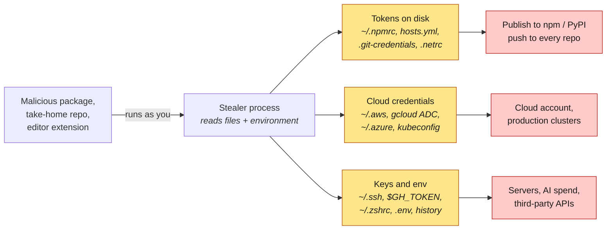

# blastradius

[](https://github.com/howardhsieh/blastradius/actions/workflows/ci.yml)
[](go.mod)
[](go.mod)
[](#privacy-rules)
[](#privacy-rules)
[](LICENSE)

**If a credential stealer ran on your laptop today, what would it walk away with?**


`blastradius` is an offline inventory of the credentials sitting on a developer
workstation: GitHub and npm tokens, cloud keys, kubeconfigs, SSH keys, AI-provider
API keys, `.env` files, secrets typed into the shell history. For each one it tells
you where it is, what it unlocks, whether it expires, and what to do about it. It
**never prints a secret** — every entry shows the first 8 hex characters of the
secret's SHA-256 instead — and it **never touches the network unless you ask**:
`--probe` sends each credential to its own service's official API host, and nowhere
else, to learn what it can actually do.

It is the companion to [preflight](https://github.com/howardhsieh/preflight). preflight
asks *"will this repository run code on my machine?"*; blastradius asks *"and if it
does, how bad is it?"*. It was built after the **Shai-Hulud** npm worm (September 2025),
whose payload ran TruffleHog over the victim's home directory, read `~/.npmrc`,
`GITHUB_TOKEN`, AWS/GCP/Azure credentials and `.env` files, then used the npm token it
found to publish itself into the victim's own packages.

> The scan in the GIF above runs against a throwaway fake home directory
> (`docs/demo/make-demo-home.sh`); every "secret" in it is inert filler and the AWS
> key is Amazon's published non-functional example. Your real scan reads your real
> `$HOME`, and the report still shows only SHA-256 fingerprints.

## Threat model



The attacker in this model already has code execution as your user, with no root and
no interactive access. That is exactly what a `postinstall` script, a VS Code task or
a compromised extension gets. blastradius reads the same places a stealer would read
(yellow) and reports what each one reaches (red), so you can shrink the blast radius
*before* the stealer arrives: rotate, shorten, scope, or move into a store that asks
before handing a secret out.

## What it inventories

| Provider | Where | What it reports |
|---|---|---|
| `github` | `~/.config/gh/hosts.yml` | gh OAuth tokens and PATs per host and user; keyring-backed logins are noted, not scored |
| `git-credentials` | `~/.git-credentials`, `~/.config/git/credentials` | plaintext `credential.helper=store` entries, classified by host (GitHub, GitLab, npm, PyPI …) |
| `netrc` | `~/.netrc`, `~/_netrc` | machine/login/password entries |
| `npm` | `~/.npmrc`, project `.npmrc` under `--dir` | `_authToken` (legacy UUID tokens are CRITICAL), `_auth`, `_password`; `${VAR}` references are skipped |
| `pypi` | `~/.pypirc`, `pip.conf` | upload tokens and passwords, index URLs with embedded passwords |
| `aws` | `~/.aws/credentials`, `~/.aws/config`, `sso/cache`, `cli/cache` | long-term `AKIA` keys vs temporary `ASIA` keys, role profiles chained from each key, SSO sessions with expiry |
| `gcp` | `~/.config/gcloud`, `$GOOGLE_APPLICATION_CREDENTIALS` | user refresh tokens (ADC), service-account keys, the `credentials.db` store |
| `azure` | `~/.azure` | MSAL token caches (plaintext vs encrypted), legacy `accessTokens.json`, service-principal secrets |
| `docker` | `~/.docker/config.json`, `containers/auth.json` | plaintext `auth` entries per registry, identity tokens, credential-store usage |
| `kubernetes` | `$KUBECONFIG` / `~/.kube/config` | static tokens, client certificates (subject and expiry parsed), deprecated auth-providers, exec plugins; the contexts and clusters each user reaches |
| `ssh` | `~/.ssh/*`, `~/.ssh/config` | private keys with or without a passphrase (detected from the key header, nothing is decrypted), key type, permissions, which hosts use each key, `ForwardAgent` |
| `ai-tools` | Claude Code, Codex CLI, GitHub Copilot, Gemini CLI, Hugging Face | stored OAuth tokens and API keys |
| `env` | process environment | `GH_TOKEN`, `NPM_TOKEN`, `AWS_SECRET_ACCESS_KEY`, `ANTHROPIC_API_KEY`, `OPENAI_API_KEY`, anything named `*_TOKEN` / `*_SECRET` / `*_KEY` / `*PASSWORD*` |
| `shell-rc` | `~/.zshrc`, `~/.bashrc`, `~/.profile`, fish config … | literal `export NAME=secret` lines (values computed with `$(...)` are fine and skipped) |
| `shell-history` | `~/.zsh_history`, `~/.bash_history`, fish history | `export X_TOKEN=…`, known token shapes (`ghp_`, `npm_`, `AKIA`, `sk-ant-` …), `Authorization:` headers, `--token`/`--password` flags |
| `dotenv` | `.env`, `.env.*` under `--dir` | secret-looking variables with real-looking values; placeholders and `${VAR}` references are skipped |

Run `blastradius providers` for the list. Each credential carries:

- **service** and **kind**: what it unlocks and the shape of the secret;
- **fingerprint**: `sha256(secret)[:8]`, enough to notice the same token in several places (they are merged into one row with "also in" locations) and to compare two scans, not enough to use;
- **lifetime**: `long-term` (valid until revoked), `short-term` (expires on its own, with the expiry when the file says), or `unknown`;
- **age**: days since the file was last modified, where that says something about the key;
- **severity**: what an attacker who copies it gains.

### Rating

| | Rating | Meaning |
|---|---|---|
| 🟥 | `CRITICAL` | a long-term cloud key, service-account key, live payment key or legacy npm token is on disk |
| 🟧 | `HIGH` | long-lived tokens that give write access to source, packages or infrastructure sit in plaintext |
| 🟨 | `MODERATE` | what was found is short-lived, narrowly scoped or project-local |
| 🟩 | `LOW` | nothing long-lived in plaintext in the well-known locations |

The rating follows the worst credential; the 0–100 *exposure* score adds everything up.
Expired credentials do not count. The **Do first** list groups credentials by the fix
that removes them, ordered by the worst credential each fix covers: rotate, switch to
short-lived or SSO credentials, add a passphrase, use granular npm tokens with 2FA,
stop exporting keys globally.

## Privacy rules

These are design constraints, not configuration, and the tests enforce the first one.

1. **No secret is ever printed, logged or written to a report.** The `Credential` type
   has no field that could hold one; providers hash the value the moment they read it.
   A test builds a home directory with 50+ fake credentials and asserts that none of
   them, nor any encoding of them, appears in the table or JSON output.
2. **Offline by default.** `scan` makes no network connection. `--probe` is an
   explicit opt-in that sends each credential only to its own service's official API
   host, from a list hard-coded in the binary (plus hosts you name with
   `--probe-host` / `--probe-cluster`), prints that list before the first request,
   and keeps only the service's answer. See [Probing](#probing---probe).
3. **Local machine only.** There is no remote, batch or agent mode, no upload, no
   telemetry, no auto-update. A tool that collects credentials from many machines is
   a stealer with a nicer README.
4. **Reports are files you own.** `-o` writes with mode `0600`. Fingerprints identify a
   secret, so treat a report as sensitive anyway.

## Install

Download a binary from the [releases page](https://github.com/howardhsieh/blastradius/releases)
(Linux, macOS and Windows, amd64 and arm64; every archive is listed in `checksums.txt`
and carries a GitHub build-provenance attestation), or build from source:

```bash
go install github.com/howardhsieh/blastradius/cmd/blastradius@latest
```

The tool has **zero third-party dependencies**; it uses only the Go standard library.

## Usage

```bash
blastradius scan                          # home directory + environment
blastradius scan --dir ~/src              # also .env files and project .npmrc under ~/src
blastradius scan -f json -o report.json   # machine-readable, mode 0600
blastradius scan --provider ssh,aws       # a subset of providers
blastradius scan --fail-on high           # exit 1 for a pre-commit or CI self-check
blastradius scan --probe                  # also ask GitHub, npm, AWS, Anthropic, OpenAI what each token can do
blastradius scan --probe --probe-cluster prod   # ... and the kubeconfig cluster named "prod"
```

| Flag | Default | |
|---|---|---|
| `-f, --format` | `table` | `table` or `json` |
| `-o, --output` | stdout | write the report to a file |
| `--dir` | | search this directory for `.env*` and `.npmrc` (repeatable, comma-separated) |
| `--provider` | all | run only these providers |
| `--min-severity` | `low` | hide table rows below this severity (`info` shows credential-store notes) |
| `--fail-on` | `none` | exit 1 if the rating is at least `moderate`, `high` or `critical` |
| `--no-env` | | do not inspect the process environment |
| `--home` | `$HOME` | scan a copied profile directory instead |
| `-v, --verbose` | | print the full remediation text under each **Do first** item |
| `--no-color` | | also honours `NO_COLOR` |
| `--probe` | off | after the offline scan, ask each service what the credentials can do; see [Probing](#probing---probe) |
| `--probe-host HOST` | | also probe this GitHub Enterprise host from `hosts.yml` (repeatable) |
| `--probe-cluster NAME` | | also probe this kubeconfig cluster (repeatable) |
| `--probe-timeout` | `60s` | bound for the whole probe phase; each single probe is bounded at 10 s |

Exit codes: 0 ok, 1 rating at or above `--fail-on`, 2 error.

## Probing (`--probe`)

The offline scan knows what a credential's *format* allows: a `ghp_` token may be
read-only, an `npm_` token may be granular, an `AKIA` key may belong to a locked-down
IAM user or to the account root. `--probe` asks each service what *this* credential
actually does, and refines the severities with the answer. It is opt-in, it runs
after the offline scan, and it tells you exactly what it is about to do before the
first request leaves the machine:

```
blastradius: --probe will send 11 credentials to the following hosts over HTTPS and keep only the answer:
  api.anthropic.com            1 anthropic credential
  api.github.com               4 github credentials
  api.openai.com               2 openai credentials
  prod.k8s.example.com:6443    2 kubernetes credentials
  registry.npmjs.org           2 npm credentials
  sts.amazonaws.com            2 aws credentials
  not probed: aws-7 (~/.zsh_history): AWS secret without its access key ID (found in shell-history); only ~/.aws/credentials, the CLI cache and the environment are probed
```

That list goes to stderr, so `-f json` output stays clean. Credentials that will not
be probed and why are listed under `not probed`; kinds that are never probed (SSH
keys, SSO sessions, keyring-backed logins, the OAuth logins of the AI CLIs, expired
credentials) are simply left alone.

### Hosts and what each probe asks

Every host a probe may contact is hard-coded in the binary; `blastradius providers`
prints the list per provider. There is no flag or environment variable that adds a
host, with two explicit exceptions (`--probe-host`, `--probe-cluster`) described below.

| Service | Host | Request | What comes back |
|---|---|---|---|
| GitHub | `api.github.com`; a GitHub Enterprise host from `hosts.yml` only with `--probe-host HOST` (`https://HOST/api/v3`) | `GET /user` | the login, and `X-OAuth-Scopes` for classic PATs and `gh` logins. Fine-grained PATs return no scopes header: GitHub does not reveal a fine-grained token's permissions to the token itself, so they are reported as fine-grained and left at MEDIUM |
| npm | `registry.npmjs.org` | `GET /-/whoami`, `GET /-/npm/v1/tokens` | the user name, and this token's own entry: **read-only**, **automation** (publishes without 2FA) or **publish**. Granular tokens are not listed by that endpoint and are reported as such |
| AWS | `sts.amazonaws.com` | `sts:GetCallerIdentity`, signed in-process with SigV4 (`crypto/hmac` + `crypto/sha256`, no SDK); session keys add `X-Amz-Security-Token` | account, ARN and principal type: IAM user, assumed role, or the account **root** |
| Kubernetes | each cluster's `server:` from the kubeconfig, only with `--probe-cluster NAME` | `POST /apis/authorization.k8s.io/v1/selfsubjectrulesreviews` in the context's namespace, verified against the cluster's CA; bearer token or mutual TLS with the client certificate | the rules the user holds: `* on *` (cluster-admin), what it can write, what it can only read |
| Anthropic | `api.anthropic.com` | `GET /v1/models` | live or rejected; no completion is requested, so the probe costs nothing |
| OpenAI | `api.openai.com` | `GET /v1/models` | live or rejected |

`GetCallerIdentity` is the one AWS call every credential may make; it reveals only
the caller's own identity. GovCloud and China-partition keys are rejected by the
global endpoint and show up as "rejected".

### What changes in the report

Each probed row gets a `↳` line with the service's answer, the host, and when it
was asked:

```
 [HIGH]     github  ~/.config/gh/hosts.yml:3
            GitHub CLI OAuth token for howardhsieh on github.com
            → howardhsieh@github.com  ·  sha256:1a2b3c4d  ·  long-term
            ↳ acts as howardhsieh · scopes: gist, read:org, repo, workflow · api.github.com · probed 2026-10-22T12:00:00Z
```

The JSON report gains `reach` on each probed credential (`host`, `live`, `identity`,
`token_type`, `scopes`, `permissions`, `read_only`, `bypass_2fa`, `admin`, `summary`,
`probed_at`), a top-level `probed_hosts` list, and `offline: false`. Severities are
then refined and the rating, score and **Do first** list recomputed:

| The service says | Severity becomes |
|---|---|
| the credential is rejected (HTTP 401 / `InvalidClientTokenId`) | LOW, with "delete credentials the service no longer accepts" |
| GitHub classic token or `gh` login with `repo` + `admin:org` | stays HIGH; the summary says it is full control of every repository and organisation |
| GitHub token whose scopes are all read-only, or empty | MEDIUM |
| GitHub fine-grained PAT | MEDIUM (what the format allows; permissions are not introspectable) |
| npm token listed as read-only | MEDIUM |
| npm token listed as automation (publishes without 2FA) | CRITICAL, with its own advice |
| AWS key whose ARN is the account root | CRITICAL, with its own advice: delete the root key, hardware MFA |
| Kubernetes `*` on `*` on any probed cluster | CRITICAL |
| Kubernetes read-only on every probed cluster | MEDIUM |

Probe failures (service down, timeout, file rotated between scan and probe) become
lines under **Not read or not probed** and never abort the scan: you always get at
least the offline result.

### Why Kubernetes needs `--probe-cluster`

Every other probe goes to a host that is written into the binary and can be read
in the source. A kubeconfig's `server:` is whatever the file says. Someone who can
write your kubeconfig, or a stale entry for a cluster that is gone and whose DNS
name somebody else now owns, could turn a "probe" into a delivery of your bearer
token to a host of their choosing, and the tool would have no list to check that
host against. So the kubeconfig is not treated as an allow-list: you name each
cluster with `--probe-cluster NAME`, the consent output shows the API server host it
resolves to, and the request is verified against the cluster's own CA. A cluster
with `insecure-skip-tls-verify: true` is refused; blastradius never turns TLS
verification off. The same logic applies to `--probe-host` for GitHub Enterprise.

### What keeps the probe honest

These are properties of the code, each pinned by a test:

- **The record still has no secret.** A prober re-reads the secret from the
  credential's location at probe time, and only accepts a value whose SHA-256 matches
  the fingerprint the scan recorded; a token rotated between scan and probe is not
  sent (`TestSecretAtRecoversEveryProbeableSecret`, `TestProbeKube`).
- **Hosts are enforced, not assumed.** Every HTTP client is wrapped in a transport
  that refuses any host outside that prober's list, allows HTTPS only and follows no
  redirects; a whole-fixture probe is checked to have contacted nothing but the
  declared hosts (`TestAllowListTransport`, `TestProbePlanAndHosts`, `TestProbeCLI`).
- **The answer is scrubbed.** Everything a service returns is cleaned of the secret,
  its base64 forms and any fragment of it before it is kept. A fake API that echoes
  the token back as the login, the scopes, the ARN and the Kubernetes resources
  produces a report with no trace of it (`TestNoSecretInAnyOutput/hostile-api`).
- **Nothing to probe, nothing sent** (`TestProbeNoCredentialsNoRequests`).
- **Bounded and transparent.** 10 s per probe, `--probe-timeout` (60 s) for the
  phase, `HTTPS_PROXY` honoured through `http.ProxyFromEnvironment`, User-Agent
  `blastradius/<version>`, response bodies capped at 1 MiB, errors never include a
  response body.
- **The test suite never touches the network.** Every API is a `net/http/httptest`
  stand-in; the SigV4 signer is checked against the AWS documentation's
  key-derivation vector and against signatures generated with botocore for the
  exact request blastradius sends.

## Design principles

- **Read like a stealer, report like an auditor.** The providers open exactly the
  files a credential stealer opens, and keep nothing but a hash and metadata.
- **Explain the reach.** A kubeconfig user is listed with the clusters and namespaces
  its contexts point at; an AWS key with the role profiles that chain from it; an SSH
  key with the hosts that use it. The question is always "what does this unlock?".
- **Static attributes first.** Long-term vs short-term, expiry, passphrase, age and
  storage are all visible offline and decide most of the advice. Scopes and
  permissions need the network; that is `--probe`, a separate, opt-in step that
  announces its targets first.
- **No dependencies, no network by default.** The scanner cannot be the exfiltration
  channel it warns about: offline it opens no socket, and with `--probe` a secret can
  only travel to its own service's API host, which the code enforces at the
  transport.

## Limitations

- blastradius reads **well-known locations**. A token in `~/notes/todo.txt` is not found;
  use `--dir` for project trees, and a general secret scanner for everything else.
- Severity is **static** unless you probe. A `ghp_` token may be read-only and an
  `npm_` token may be granular and package-scoped; offline the tool can only say what
  the format allows. `--probe` asks GitHub, npm, AWS, Kubernetes, Anthropic and
  OpenAI; GCP, Azure, PyPI, Docker, Slack and the rest stay static for now.
- GitHub **fine-grained PAT permissions are not introspectable**: the API does not
  tell a token what it may do, so a probed fine-grained PAT is reported as live and
  fine-grained, not as read-only or read-write.
- OS keychains are not opened. A `gh` login whose token lives in the macOS Keychain is
  reported as LOW with a note, because a process running as you can still request it.
- Encrypted keys are not decrypted; "passphrase-protected" is read from the key header.

## Roadmap

- More probers behind the same allow-list discipline: GCP (`oauth2.googleapis.com`
  tokeninfo), Azure (Graph `/me`), PyPI, Docker Hub, Slack `auth.test`, Hugging Face
  `/api/whoami-v2`; GitHub fine-grained PATs once GitHub exposes their permissions
  to the token.
- `--probe` for `--provider` subsets and a `--probe-only` re-run that reuses a saved
  JSON report instead of rescanning.
- SARIF output, so a self-check can land in GitHub code scanning like preflight's.

## Development

```bash
go test -race ./...                        # no test touches the network; APIs are httptest stand-ins
go run ./cmd/blastradius scan
BLASTRADIUS_SAMPLE=/tmp/sample.txt go test ./internal/report -run TestWriteSample  # README sample
```

All fixtures are generated at test time into a temporary directory by
`internal/testfixture`; every secret in them contains the marker `FAKEBLAST` and none
of them is valid anywhere. CI runs the suite on Linux, macOS and Windows and smoke-tests
the binary against an empty home directory, never against the runner's own.

Re-record the demo GIF with `docs/demo/record.sh` (needs [vhs](https://github.com/charmbracelet/vhs)).
It builds the binary, generates an inert fake home with `docs/demo/make-demo-home.sh`,
points `HOME` at it, and scans with `--no-env`, so the recording never reads your real
credentials.

## License

MIT
